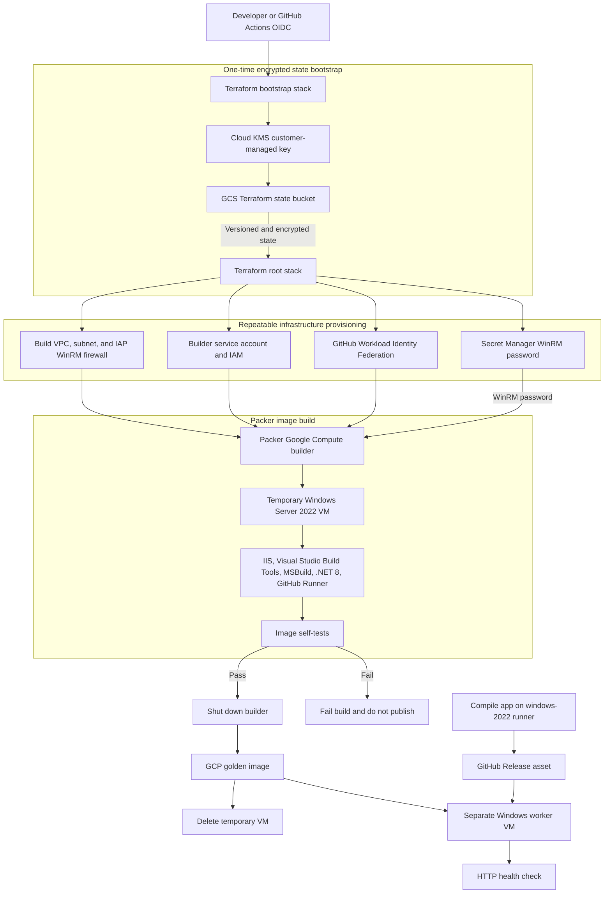

# Windows Server 2022 Golden Image

This repository builds a Windows Server 2022 image on Google Cloud with Terraform and Packer, then compiles and deploys a small .NET application to a separate worker VM. Terraform creates the VPC, IAP firewall for WinRM, builder service account, GitHub Actions Workload Identity Federation, Google Secret Manager secret, and optional worker VM. Packer creates the image and installs IIS, Visual Studio 2022 Build Tools, MSBuild, .NET 8, and GitHub Actions runner binaries.

## Demo workflow



## Prerequisites

- Terraform 1.6+
- Packer 1.9+
- Google Cloud CLI
- A GCP project with billing enabled
- Local Google credentials with permission to create the Terraform resources

Terraform state is stored in a dedicated, versioned GCS bucket encrypted with a customer-managed Cloud KMS key. The bucket is managed by a separate `bootstrap/` stack so the image infrastructure never creates or destroys its own backend.

## Network and port design

Terraform creates one custom-mode VPC named `windows-image-build` with one regional subnet by default:

| Component | Default value | Purpose |
| --- | --- | --- |
| VPC | `windows-image-build` | Isolates the image builder and demo worker from unrelated networks |
| Subnet | `windows-image-build-subnet` | Regional subnet in `us-central1` |
| Subnet CIDR | `10.20.0.0/24` | Private address range for builder and worker instances |
| Builder tag | `packer-windows-builder` | Selects the temporary Packer VM for IAP WinRM access |
| Worker tag | `windows-demo-worker` | Selects the optional application VM for port 8080 access |

### Ingress ports

| Destination | Port/protocol | Source | Why it is open | Lifecycle |
| --- | --- | --- | --- | --- |
| Temporary Packer builder | TCP `5986` | `35.235.240.0/20` | Google Cloud IAP TCP forwarding to HTTPS WinRM | Temporary; builder is shut down and deleted after the image build |
| Demo worker | TCP `8080` | `0.0.0.0/0` | HTTP access to the sample application's `/health` endpoint | Demo-only; restrict to a trusted CIDR before reuse |

The IAP source range is Google’s documented TCP forwarding range. The builder does not expose WinRM to the public internet. SSH `22`, RDP `3389`, HTTP `80`, and HTTPS `443` ingress rules are not created by this repository.

### Egress and control-plane traffic

Instances and GitHub Actions need outbound HTTPS (`TCP 443`) for the following dependencies:

- Google APIs: Compute Engine, IAM, STS, IAP, Secret Manager, Cloud KMS, and GCS state.
- GitHub Actions OIDC token exchange and GitHub Release asset downloads.
- Windows provisioning downloads from `aka.ms`, `dot.net`, and `api.github.com`.
- Visual Studio Build Tools and .NET SDK package feeds.

The Terraform configuration does not create custom egress-deny rules or Cloud NAT. The builder and worker therefore need a usable external egress path in the selected GCP network. If external IPs are disallowed in a production design, add Cloud NAT and private access to the required Google APIs, then remove the builder’s public egress path.

### Traffic flow

1. GitHub Actions exchanges its OIDC token through Workload Identity Federation and obtains the Terraform executor service account.
2. Terraform creates the VPC and subnet, then the temporary Packer VM receives the `packer-windows-builder` network tag.
3. Packer opens an IAP tunnel to the VM and communicates over WinRM TLS on TCP 5986.
4. The VM downloads provisioning dependencies over HTTPS, runs self-tests, shuts down, and becomes the golden image.
5. Terraform creates the separate worker VM from that image. The worker downloads the public GitHub Release asset over HTTPS and runs the application on TCP 8080.
6. GitHub Actions calls the worker’s public `8080/health` endpoint to verify deployment.

For production, keep the state bucket and Secret Manager private, replace the worker’s `0.0.0.0/0` rule with a trusted source range or load balancer, and use controlled egress rather than broad internet access.

## Provision infrastructure

Create a local `terraform.tfvars` file:

```hcl
project_id        = "my-gcp-project"
github_repository = "Deck-J/Packer_Windows_Demo"
terraform_executor_service_account = "terraform-executor@my-gcp-project.iam.gserviceaccount.com"
region            = "us-central1"
zone              = "us-central1-a"
```

## Bootstrap the encrypted state backend

The repository includes [bootstrap.yml](.github/workflows/bootstrap.yml). Run it once with **Actions > Bootstrap Terraform state > Run workflow**. It creates the versioned, KMS-encrypted GCS state bucket and grants the Terraform executor access to it. No local Terraform, Packer, or Google Cloud CLI commands are required.

The bootstrap workflow requires the GitHub repository variables described below. Because GitHub Actions needs credentials before it can create credentials, the executor service account and its GitHub OIDC provider must be created once by a GCP platform administrator. After that one-time trust setup, all repository infrastructure operations run through GitHub Actions.

The build workflow initializes the root stack against the encrypted bucket and runs `terraform plan`, `terraform apply`, Packer, image publication, worker deployment, and the health check on GitHub-hosted runners.

Do not delete the bootstrap state bucket or its KMS key. The bucket has object versioning enabled so previous workload state versions can be recovered.

Terraform creates `packer-winrm-password` in Google Secret Manager. The builder service account has `roles/secretmanager.secretAccessor`; GitHub Actions receives that access through Workload Identity Federation.

## Build the image

The workflow compiles [WorkerDemo.csproj](app/WorkerDemo.csproj) on a `windows-2022` runner with `dotnet publish`. It packages the published output as `worker-demo.zip` and uploads that binary as a prerelease asset attached to the current GitHub repository. No application binary is committed to git.

Choose **Actions > Build Windows golden image > Run workflow**. The workflow reads the Packer variables from Terraform outputs, retrieves the WinRM password directly from Secret Manager, and never writes it to a repository file.

Before publishing, Packer runs [self-test-windows.ps1](scripts/self-test-windows.ps1) inside the builder. It verifies IIS, MSBuild, the Roslyn C# compiler, the .NET SDK, and the GitHub Actions runner files. A failed check fails the build. After the checks pass, the Google Compute builder shuts down the temporary VM, captures the image, and deletes the temporary VM. The `shutdown_timeout` is set to 10 minutes so the image capture has time to complete without leaving the VM running indefinitely.

After the image is captured, Terraform creates a separate `windows-demo-worker` VM from that golden image. Its startup script downloads the GitHub Release asset, extracts it to `C:\WorkerDemo`, starts the .NET application on port `8080`, and the workflow polls `/health` until the application responds. The worker is enabled only during the workflow's second Terraform apply, when `golden_image` and `app_release_url` are supplied.

## GitHub Actions authentication

The repository includes [build-image.yml](.github/workflows/build-image.yml). It runs Terraform and Packer on pushes to `main` when infrastructure or build files change, and can also be started with `workflow_dispatch`.

One-time GCP setup is required before the first workflow run. Create a dedicated `terraform-executor` service account and a GitHub OIDC Workload Identity Provider outside this stack, then grant the executor:

- `roles/storage.objectAdmin` on the encrypted Terraform state bucket
- Permission to manage the APIs, IAM, networking, Secret Manager, and Compute resources in this demo project

The initial trust setup must happen outside GitHub Actions because an action cannot authenticate until its OIDC provider already exists. Do not use a service-account JSON key.

Create these GitHub repository variables:

| Variable | Value |
| --- | --- |
| `GCP_PROJECT_ID` | GCP project ID |
| `GCP_WORKLOAD_IDENTITY_PROVIDER` | Full resource name of the pre-created GitHub OIDC provider |
| `GCP_TERRAFORM_SERVICE_ACCOUNT` | Executor service account email |
| `TF_STATE_BUCKET` | Encrypted GCS state bucket name |

The workflow requests an OIDC token and authenticates without a long-lived JSON key:

```yaml
permissions:
  id-token: write
  contents: read

- uses: google-github-actions/auth@v2
  with:
    workload_identity_provider: ${{ vars.GCP_WORKLOAD_IDENTITY_PROVIDER }}
    service_account: ${{ vars.GCP_TERRAFORM_SERVICE_ACCOUNT }}
```

The workflow compiles the application on Windows, uploads the binary as a GitHub Release asset, applies Terraform, reads the WinRM password from Secret Manager, validates Packer, builds the image, runs the Windows self-tests, creates the separate worker VM, and verifies its health. The root stack grants the executor read access to the generated WinRM secret through `terraform_executor_service_account`.
# Packer_Windows_Demo